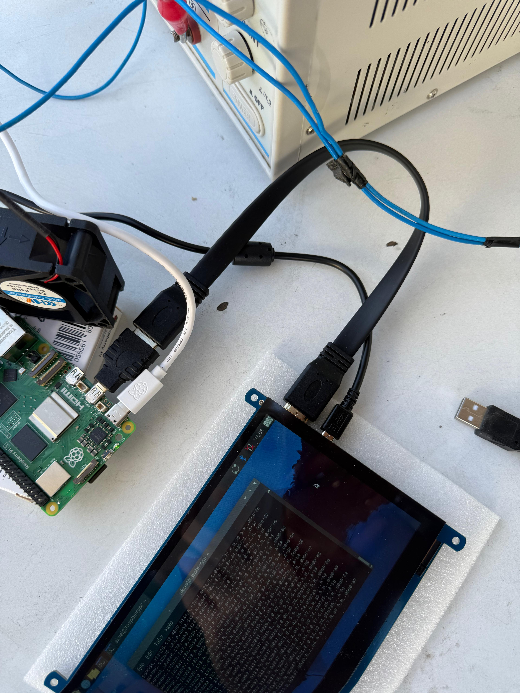
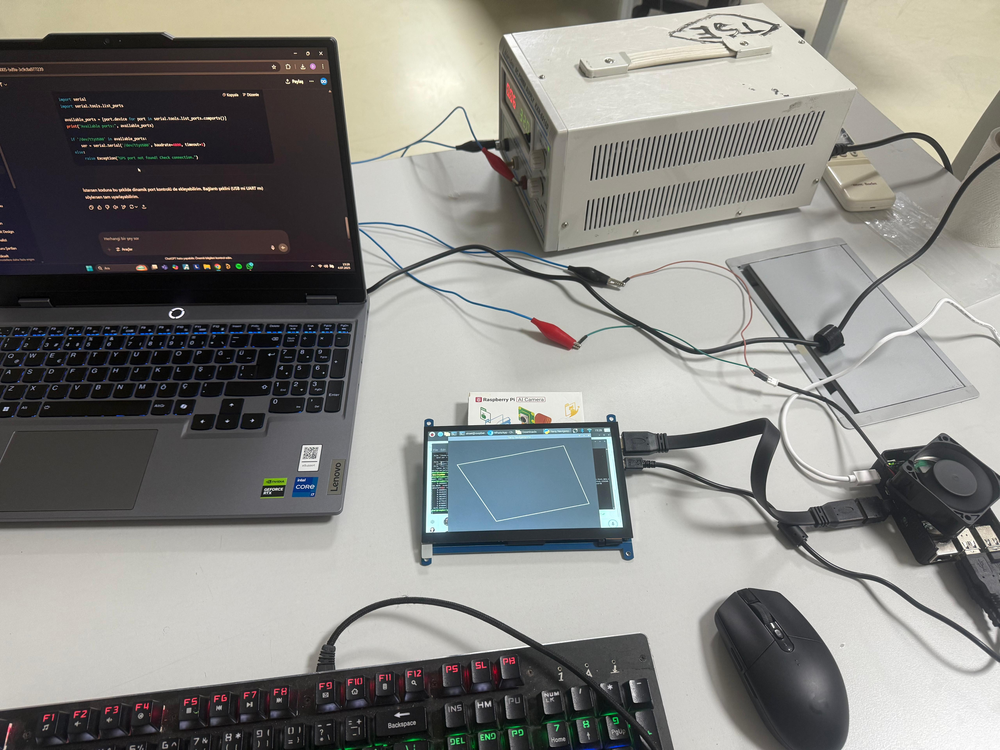
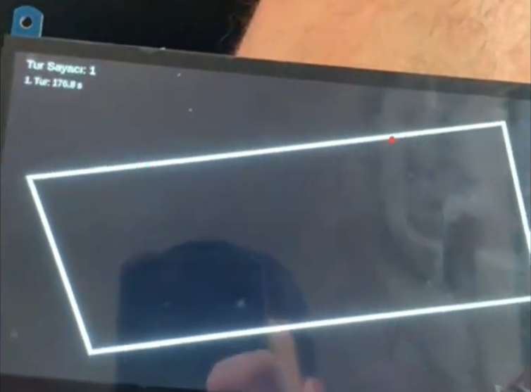
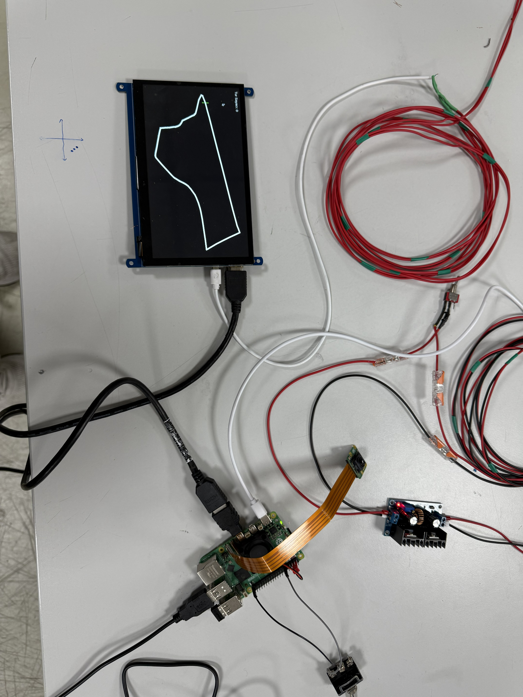

# Race Navigation System

> A Raspberry Pi-based project for displaying a vehicle's position on a predefined route in race and route-tracking scenarios.

## Overview

The system combines GPS position data with a GPX route and displays both through a graphical interface. Its objective is to provide real-time location tracking, route interpretation and an at-a-glance view for the user.

## Work performed

- Set up the Raspberry Pi system.
- Read live position data from a GPS module.
- Integrated GPX route data and developed route-position matching logic.
- Displayed the route and vehicle position in a graphical interface.
- Implemented a real-time tracking structure.

## Technologies

- Raspberry Pi and GPS module
- Python and GPX route data
- Graphical interface components

The project brings together embedded-system development, GPS data processing, route matching, real-time visualization and user-interface development.

## Documentation and project files

- [Technical design report](race_navigation_technical_design_report.pdf)
- [Python implementation](gpx_viewer.py)
- [Race route](track.gpx)

The technical report describes the system architecture, design decisions and navigation logic. The GPX file contains the predefined race track used by the project.

## Project images

## Future improvements

- Add speed and direction information.
- Calculate remaining distance.
- Use a more advanced map interface.
- Add touchscreen support.
- Improve position-correction accuracy.

## Summary

This project presents a functional prototype for real-time location tracking and route visualization, and provides practical experience with Raspberry Pi-based system development and hardware-software integration.
